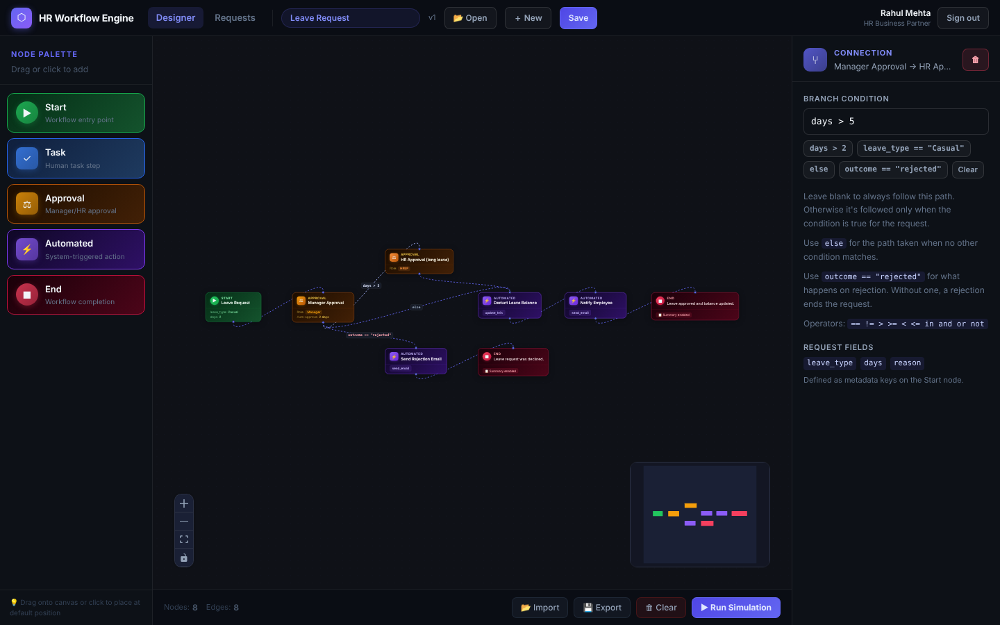
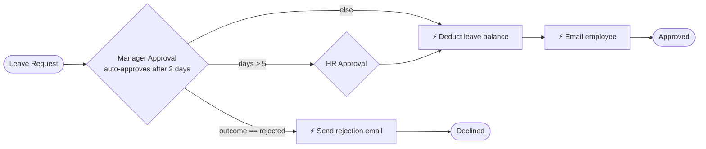
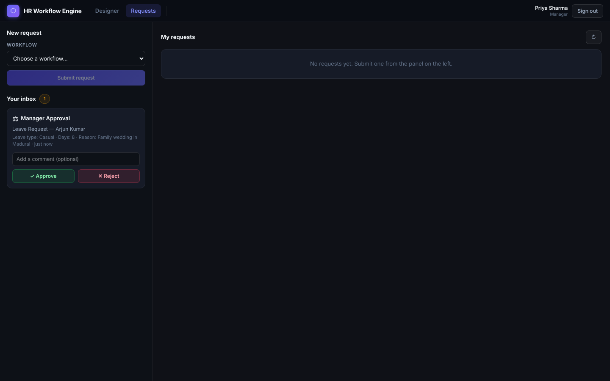
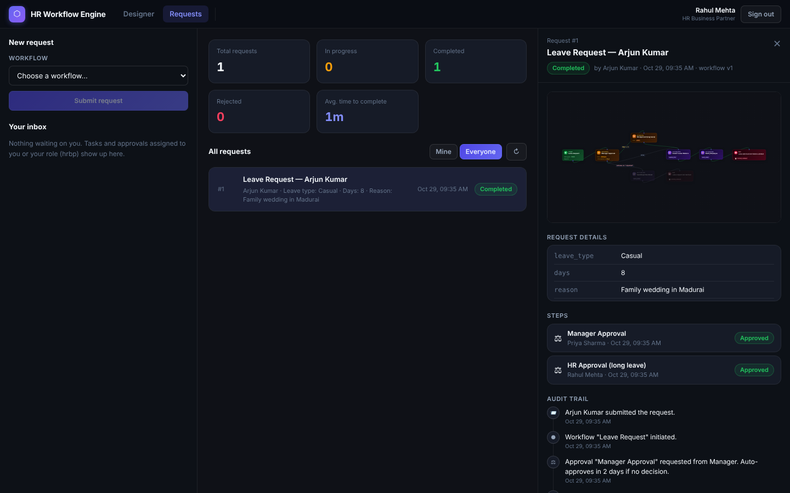
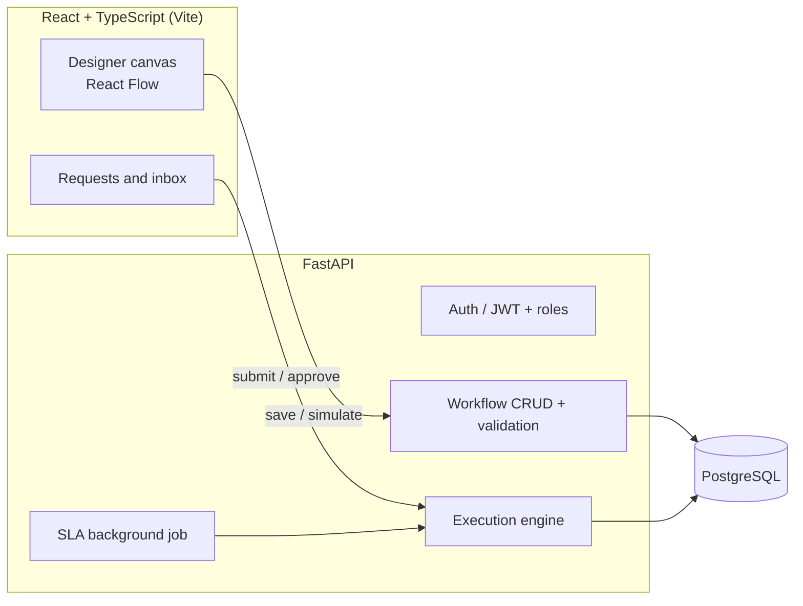

# HR Workflow Engine

A full-stack HR workflow platform. HR teams **design** approval workflows on a visual canvas, employees **submit requests** against them, and a backend **engine executes** each request: routing approvals by role, branching on request data, running automations, auto-approving on SLA timeout, and recording every step in an audit trail.

**Stack:** React 19 · TypeScript · React Flow · Tailwind CSS v4 · FastAPI · SQLAlchemy 2 · PostgreSQL · JWT · pytest · Docker · GitHub Actions



---

## What it does

| | |
|---|---|
| **Visual designer** | Drag-and-drop canvas with five node types: Start, Task, Approval, Automated step, End. Workflows are saved to the server and versioned. |
| **Real execution engine** | Submitting a request creates a workflow instance. Automated steps run immediately; the engine pauses at tasks and approvals until the right person acts. |
| **Conditional branching** | Edges carry conditions like `days > 5`, `department == "Engineering"`, `else`, or `outcome == "rejected"`. Conditions are parsed with Python's `ast` against a whitelist, so there's no `eval()`. |
| **Role-based access** | JWT auth with five roles (admin, HRBP, manager, director, employee). Approvals go to everyone with the approver role; nobody can approve their own request. |
| **SLA auto-approval** | An approval's threshold (in days) sets a deadline. A background job auto-approves overdue steps and logs it. |
| **Audit trail and progress view** | Every action is recorded. The request page replays the workflow graph, highlighting the path taken and the step that's waiting. |
| **Simulation** | Dry-run any workflow with test values. It uses the *same* routing code as real execution, so what you preview is what happens. |
| **Versioning** | Editing a workflow bumps its version. In-flight requests keep running on the snapshot they started with. |

### Example: the seeded Leave Request workflow



A 2-day leave needs only the manager. An 8-day leave also goes to HR. A rejection from the manager follows the rejection branch; a rejection from HR (which has no rejection branch) ends the request as `rejected`.

| Role-based inbox | Request detail with progress and audit trail |
|---|---|
|  |  |

---

## Architecture



```
backend/
├── app/
│   ├── main.py          # App setup, CORS, startup seeding, SLA background loop
│   ├── models.py        # User, Workflow, WorkflowInstance, PendingAction, AuditEvent
│   ├── graph.py         # Graph parsing, validation (cycles, reachability), safe condition evaluator
│   ├── engine.py        # Executor → DbExecutor (real) and SimulationExecutor (dry run)
│   ├── automations.py   # Action catalogue + pluggable handlers, {{variable}} templating
│   ├── auth.py          # bcrypt passwords, JWT, role guards
│   ├── seed.py          # Demo users and template workflows
│   └── routers/         # auth, workflows, instances (requests, inbox, stats)
└── tests/               # 34 pytest tests
src/
├── components/
│   ├── Canvas/          # React Flow canvas, custom nodes, palette, workflow browser
│   ├── NodeForms/       # Node config forms + edge condition editor
│   ├── Sandbox/         # Simulator drawer and execution log
│   ├── Requests/        # Submit form, inbox, request detail, progress graph
│   └── Auth/            # Login screen with demo accounts
├── services/            # api.ts (real API or mock), http.ts (fetch + JWT)
└── hooks/ types/ utils/
```

### How the engine works

1. **Start** — the Start node's fields become the request form. Submitted values (plus `requester_name`, `requester_email`, `requester_department`) become the instance's variables.
2. **Walk** — the executor processes nodes from a queue. For each node it picks the outgoing edges to follow:
   - unconditional edges are always followed (parallel branches),
   - conditional edges are followed when their condition is true,
   - an `else` edge is followed only if no other condition matched.
3. **Pause** — Task and Approval nodes create a `PendingAction` and stop that branch.
4. **Resume** — when someone approves, rejects or completes a step, the executor continues from that node with `outcome` set. On rejection, only branches that test `outcome` are followed; if there are none, the request is rejected.
5. **Finish** — when no open actions remain, the instance is marked `completed`, and every event lands in the audit log.

The same `Executor` base class powers both `DbExecutor` (persists actions and events) and `SimulationExecutor` (resolves human steps instantly), so simulation and execution can't drift apart.

---

## Running it locally

### 1. Backend

```bash
cd backend
python -m venv .venv && source .venv/bin/activate   # Windows: .venv\Scripts\activate
pip install -r requirements-dev.txt
uvicorn app.main:app --reload
```

This uses SQLite by default and seeds demo users plus two template workflows. API docs are at **http://localhost:8000/docs**.

To use PostgreSQL instead, start the database and API with Docker:

```bash
docker compose up --build
```

### 2. Frontend

```bash
npm install
echo "VITE_API_URL=http://localhost:8000" > .env.local
npm run dev
```

Open **http://localhost:5173** and pick a demo account (password `demo1234`):

| Account | Role | Try this |
|---|---|---|
| Arjun Kumar `employee@demo.com` | Employee | Submit an 8-day leave request |
| Priya Sharma `manager@demo.com` | Manager | Approve it from the inbox |
| Rahul Mehta `hrbp@demo.com` | HR Business Partner | Give the second approval, view stats, edit workflows |
| Vikram Iyer `director@demo.com` | Director | Approve onboarding headcount |
| Aditi Rao `admin@demo.com` | Admin | Complete IT tasks, run the SLA job |

> Without `VITE_API_URL`, the frontend runs as an offline designer against an in-browser mock API.

### Tests

```bash
cd backend && pytest                 # SQLite
DATABASE_URL=postgresql+psycopg://hr:hr@localhost:5432/hr_test pytest   # PostgreSQL
npm run lint && npm run build        # frontend checks
```

CI runs the backend suite on both SQLite and PostgreSQL, and lints and builds the frontend, on every push.

---

## API overview

| Method | Endpoint | Who | Purpose |
|---|---|---|---|
| POST | `/api/auth/login` | anyone | Get a JWT |
| GET | `/api/workflows` | signed in | List workflows |
| POST / PUT / DELETE | `/api/workflows[/{id}]` | admin, HRBP | Create, update (bumps version), delete |
| POST | `/api/validate`, `/api/simulate` | anyone | Validate or dry-run a graph |
| POST | `/api/instances` | signed in | Submit a request |
| GET | `/api/instances?scope=mine\|all` | signed in | Your requests (admin/HRBP can see all) |
| GET | `/api/instances/{id}` | involved users | Request detail, steps and audit trail |
| POST | `/api/instances/{id}/cancel` | requester, admin | Cancel an active request |
| GET | `/api/inbox` | signed in | Steps waiting on you or your role |
| POST | `/api/actions/{id}/decide` | assignee | `approve`, `reject` or `complete` |
| GET | `/api/stats` | admin, HRBP | Request counts and average completion time |

Full interactive docs at `/docs`.

---

## Design decisions

- **Snapshot on start.** Each instance stores the graph it started with, so editing a workflow never breaks requests already in progress.
- **No `eval()`.** Branch conditions are parsed into an AST and only comparison, boolean and literal nodes are allowed. Function calls, attribute access and arithmetic are rejected at validation time.
- **Validation on both sides.** The client gives instant feedback; the server is the source of truth and refuses to save or start a workflow with blocking errors (missing Start/End, cycles, unreachable End, bad conditions, unknown actions).
- **Pluggable automations.** Built-in actions (email, Slack, JIRA, HRIS) are simulated handlers. Swapping one for a real integration doesn't touch the engine.
- **Separation of duties.** Approvers can't approve their own requests.

## Roadmap

- Parallel branches that join (wait for all incoming paths)
- Real email/Slack integrations behind the handler interface
- Alembic migrations
- Undo/redo in the designer
- Playwright end-to-end tests

---

*This started as a frontend case study (React Flow designer with a mock API) and was extended into a full-stack application with a real execution engine, authentication and persistence.*
